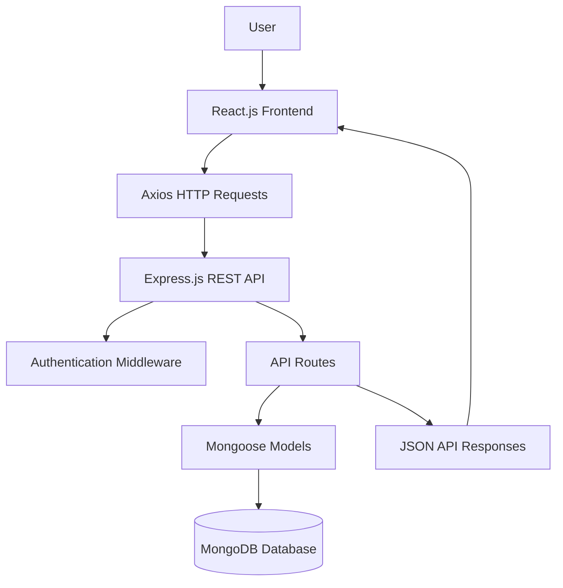
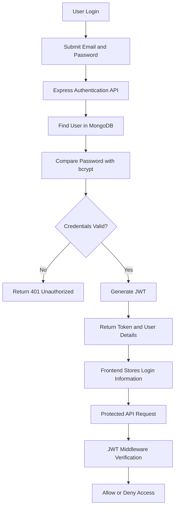

# ShopEase – Full-Stack E-Commerce Web Application


## Overview

ShopEase is a full-stack e-commerce web application developed using React.js, Node.js, Express.js, and MongoDB. It provides product browsing, search, category filtering, product details, shopping cart management, user authentication, and an administrative dashboard.

The application follows a frontend-backend architecture. The React frontend communicates with REST APIs developed using Express.js, while MongoDB stores user, product, and order information.

The project also includes JWT-based authentication, role-based authorization, password hashing, product reviews, inventory checks, and administrative sales analytics.

## Key Features

### Customer Features
- Browse available products.
- Search products by name.
- Filter products by category.
- View product descriptions, prices, ratings, and stock availability.
- View individual product details.
- Add products to a shopping cart.
- Store cart items in browser local storage.
- Sign in using email and password.
- View product reviews through the backend API.
- Access customer order-related API functionality.

### Authentication and Authorization
- User registration and login REST APIs.
- JWT-based authentication.
- Password hashing using bcryptjs.
- Customer and administrator roles.
- Protected backend routes.
- Role-based access control for administrative operations.

### Product Management
- Create, update, and delete products through admin APIs.
- Retrieve product information.
- Search products by name.
- Filter products by category.
- Sort products by price and rating.
- Support pagination.
- Maintain product stock information.
- Submit customer reviews through an authenticated API.

### Order Management
- Create orders through the backend API.
- Validate product availability before order creation.
- Update product stock when an order is created.
- Retrieve a customer's orders.
- Retrieve individual order details.
- Maintain order status information.
- Support mock payment-result data.

### Admin Dashboard
- View total registered customers.
- View total products.
- View total orders.
- View total sales from orders marked as paid.
- Access administrative analytics through a protected API.
- Manage products and orders through backend endpoints.

## Technology Stack

| Category | Technologies |
|---|---|
| Frontend | React.js 18 |
| Programming Language | JavaScript |
| UI Routing | React Router DOM |
| HTTP Client | Axios |
| Icons | Lucide React |
| State Management | React Hooks |
| Backend | Node.js, Express.js |
| Database | MongoDB |
| ODM | Mongoose |
| Authentication | JSON Web Token (JWT) |
| Password Security | bcryptjs |
| Configuration | dotenv |
| API Testing | Jest, Supertest |

## Application Architecture

ShopEase follows a client-server architecture.



### Frontend
The React application provides the user interface and handles page navigation, product display, login, and shopping cart interactions.

### Backend
The Express.js application exposes REST API endpoints for authentication, products, orders, and administrative operations.

### Database
MongoDB stores application data using Mongoose schemas and models.

## Project Structure

```text
ShopEase-Ecommerce-Web/
│
├── frontend/
│   ├── public/
│   │   └── index.html
│   │
│   ├── src/
│   │   ├── pages/
│   │   │   ├── Home.js
│   │   │   ├── ProductDetail.js
│   │   │   ├── Cart.js
│   │   │   ├── Login.js
│   │   │   └── AdminDashboard.js
│   │   │
│   │   ├── App.js
│   │   └── index.css
│   │
│   └── package.json
│
├── backend/
│   ├── middleware/
│   │   └── auth.js
│   │
│   ├── models/
│   │   ├── User.js
│   │   ├── Product.js
│   │   └── Order.js
│   │
│   ├── routes/
│   │   ├── auth.js
│   │   ├── products.js
│   │   ├── orders.js
│   │   └── admin.js
│   │
│   ├── tests/
│   │   └── api.test.js
│   │
│   ├── server.js
│   ├── seed.js
│   └── package.json
│
├── .env.example
├── .gitignore
└── README.md
```

## Database Design

The application uses MongoDB with three primary Mongoose models.

### 1. User Model

Stores customer and administrator account information.

| Field | Description |
|---|---|
| name | User's name |
| email | Unique email address |
| password | Hashed password |
| role | Customer or admin |
| addresses | User address information |
| timestamps | Creation and update timestamps |

### 2. Product Model

Stores product information and customer reviews.

| Field | Description |
|---|---|
| name | Product name |
| description | Product description |
| price | Product price |
| category | Product category |
| stock | Available stock |
| imageUrl | Product image URL |
| rating | Average product rating |
| numReviews | Number of reviews |
| reviews | Customer review information |

### 3. Order Model

Stores order details, shipping information, and payment-result data.

| Field | Description |
|---|---|
| user | Reference to the customer |
| orderItems | Products included in the order |
| shippingAddress | Delivery address |
| paymentMethod | Payment method description |
| paymentResult | Mock payment-result information |
| totalPrice | Order total |
| isPaid | Payment status |
| paidAt | Payment timestamp |
| status | Order processing status |

## REST API Documentation

The backend exposes the following REST API endpoints.

### Authentication APIs

| Method | Endpoint | Description | Access |
|---|---|---|---|
| POST | `/api/auth/register` | Register a customer | Public |
| POST | `/api/auth/login` | Authenticate a user | Public |

### Product APIs

| Method | Endpoint | Description | Access |
|---|---|---|---|
| GET | `/api/products` | Retrieve products | Public |
| GET | `/api/products/:id` | Retrieve product details | Public |
| POST | `/api/products/:id/reviews` | Submit a product review | Authenticated |

Product listing supports category filtering, name search, sorting, and pagination through query parameters.

Example:

```http
GET /api/products?category=Electronics&sort=price_asc&page=1&limit=10
```

### Order APIs

| Method | Endpoint | Description | Access |
|---|---|---|---|
| POST | `/api/orders` | Create an order | Authenticated |
| GET | `/api/orders/myorders` | Retrieve the logged-in user's orders | Authenticated |
| GET | `/api/orders/:id` | Retrieve order details | Authenticated |

### Admin APIs

| Method | Endpoint | Description | Access |
|---|---|---|---|
| GET | `/api/admin/analytics` | Retrieve store analytics | Admin |
| POST | `/api/admin/products` | Create a product | Admin |
| PUT | `/api/admin/products/:id` | Update a product | Admin |
| DELETE | `/api/admin/products/:id` | Delete a product | Admin |
| GET | `/api/admin/orders` | Retrieve all orders | Admin |
| PUT | `/api/admin/orders/:id/status` | Update order status | Admin |

### Health Check

```http
GET /api/health
```

Returns the backend service status and timestamp.

## Authentication Workflow



The authentication system uses JSON Web Tokens to identify authenticated users. Passwords are hashed before being stored in MongoDB. Administrative endpoints additionally check the user's role before allowing access.

## Installation and Setup

### Prerequisites

Install the following software before running the application:

- Node.js and npm
- MongoDB Community Server or MongoDB Atlas
- Git
- Visual Studio Code or another code editor

### Step 1: Clone the Repository

```bash
git clone https://github.com/YOUR-USERNAME/ShopEase-Ecommerce-Web.git
cd ShopEase-Ecommerce-Web
```

Replace `YOUR-USERNAME` with your GitHub username.

### Step 2: Configure the Backend

```bash
cd backend
npm install
```

Create a `.env` file inside the `backend` folder:

```env
PORT=5000
MONGODB_URI=mongodb://localhost:27017/shopease
JWT_SECRET=replace_with_a_long_random_secret
NODE_ENV=development
```

Make sure MongoDB is running before starting the backend.

### Step 3: Seed the Database

From the `backend` directory, run:

```bash
npm run seed
```

The seed script creates sample products and two sample accounts.

**Important:** The current seed script deletes existing users and products before inserting its sample data. Do not run it against a database containing data you need to preserve.

Sample accounts created by the seed script:

| Role | Email | Password |
|---|---|---|
| Admin | `admin@shopease.com` | `AdminPass123!` |
| Customer | `john@example.com` | `CustomerPass123!` |

These are development credentials only. Change or remove them before deploying the application.

### Step 4: Start the Backend

```bash
npm start
```

The backend runs at:

```text
http://localhost:5000
```

### Step 5: Start the Frontend

Open another terminal:

```bash
cd frontend
npm install
npm start
```

The React application runs at:

```text
http://localhost:3000
```

The frontend currently uses `http://localhost:5000` directly for backend API requests.

## Testing

The backend includes Jest and Supertest for API testing.

Run the backend tests from the `backend` directory:

```bash
npm test
```

The existing API test file covers:
- Successful customer registration.
- Login rejection when an incorrect password is supplied.

The test setup connects to a separate MongoDB database named `shopease_test` by default. Ensure that MongoDB is running before executing the tests.

## Security Considerations

The project includes several basic security mechanisms:

- Password hashing with bcryptjs.
- JWT-based authentication.
- Protected API routes.
- Role-based authorization for administrator operations.
- Mongoose schema validation for defined fields.

**Before production deployment:**
- Use a strong, private JWT secret stored in environment variables.
- Remove hardcoded fallback secrets from the application.
- Add request validation and stronger input sanitization.
- Configure CORS for trusted frontend origins.
- Add rate limiting and additional authentication protections.
- Review order pricing and inventory updates on the server.
- Integrate a real payment provider before accepting actual payments.

## Current Implementation Notes

This documentation reflects the source code included in the uploaded project.

- The shopping cart currently uses browser `localStorage`.
- The frontend checkout button currently displays a mock order-success message; it does not submit an order to the backend.
- The backend order API creates mock payment-result data and marks an order as paid. It does not connect to a real payment gateway.
- Product reviews and order operations are available through backend APIs, but corresponding complete customer-facing frontend workflows are not present in the inspected pages.
- The admin dashboard displays analytics. Product and order administration are implemented as backend APIs rather than complete management screens in the inspected frontend.
- Redux Toolkit is listed as a frontend dependency but is not used in the inspected source files.

## Future Enhancements

Potential improvements for future versions include:

- Connect the frontend checkout flow to the backend order API.
- Integrate a real payment gateway.
- Add a complete registration page.
- Add quantity controls and item removal in the shopping cart.
- Build customer-facing order history and tracking pages.
- Add product and order management screens to the admin dashboard.
- Improve frontend error handling and loading states.
- Add more comprehensive unit and integration tests.
- Deploy the application using cloud hosting services.

## Skills Demonstrated

- Full-stack web application development
- React.js component development
- JavaScript programming
- REST API development
- Node.js and Express.js
- MongoDB database integration
- Mongoose schemas and models
- JWT authentication and authorization
- Password hashing
- CRUD operations
- API testing with Jest and Supertest
- Frontend and backend integration

## License

This project is distributed under the MIT License.
