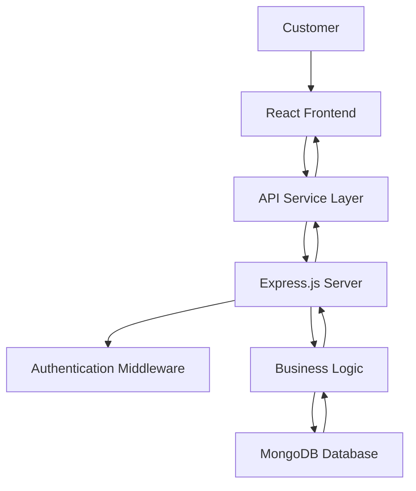

# 🛒 ShopEase – E-Commerce Web Application

A modern, responsive e-commerce web application designed to provide a seamless online shopping experience with product discovery, shopping cart management, and secure user interactions.


## 📌 Project Overview

ShopEase is a full-stack e-commerce application designed to simplify online shopping through an intuitive and responsive interface.

The application focuses on essential e-commerce operations, including product browsing, product details, cart management, customer authentication, and order processing.

The project demonstrates frontend development using ReactJS, backend development using Node.js and Express.js, and database integration using MongoDB.

## 🎯 Project Objectives

- Develop a responsive e-commerce interface.
- Implement reusable React components.
- Build RESTful APIs for application operations.
- Manage product and customer information.
- Implement shopping cart functionality.
- Understand frontend-backend communication.
- Apply modular software development practices.

## ✨ Key Features

### 1. User Authentication
- User registration and login.
- Password validation.
- Authentication using JWT, if implemented.
- Protected routes, if implemented.

### 2. Product Management
- Display available products.
- Product details and descriptions.
- Product categorization.
- Search and filtering.
- Product availability information.

### 3. Shopping Cart
- Add products to the cart.
- Update product quantities.
- Remove products.
- Calculate cart totals.

### 4. Order Management
- Checkout workflow.
- Order summary.
- Order history.
- Order status tracking, if implemented.

### 5. Responsive User Interface
- Reusable React components.
- Mobile-friendly layouts.
- Responsive navigation.
- User-friendly product cards.

## 🛠️ Technology Stack

| Technology | Purpose |
|---|---|
| ReactJS | Frontend development |
| JavaScript ES6+ | Application logic |
| HTML5 | Web structure |
| CSS3 | Styling and responsive design |
| Node.js | Backend runtime |
| Express.js | REST API development |
| MongoDB | Database |
| JWT | Authentication, if implemented |
| Git | Version control |
| GitHub | Source code management |
| Postman | API testing |

## 🏗️ System Architecture

The application follows a client-server architecture.



## 📂 Project Structure

```text
ShopEase/
│
├── frontend/
│   ├── public/
│   └── src/
│       ├── components/
│       ├── pages/
│       ├── services/
│       ├── hooks/
│       ├── context/
│       ├── assets/
│       ├── App.jsx
│       └── main.jsx
│
├── backend/
│   ├── config/
│   ├── controllers/
│   ├── middleware/
│   ├── models/
│   ├── routes/
│   ├── services/
│   └── server.js
│
├── assets/
│   └── screenshots/
│
├── .env.example
├── .gitignore
└── README.md
```

## 🔄 Application Workflow

1. Customer opens the application.
2. React renders the homepage.
3. Product information is retrieved from the API.
4. Backend processes requests.
5. MongoDB stores and retrieves application data.
6. Customer selects products.
7. Shopping cart state is updated.
8. Customer proceeds through checkout.

## 🔌 REST API Documentation

Document the actual endpoints implemented in your backend.

| HTTP Method | Endpoint | Description |
|---|---|---|
| POST | /api/auth/register | Register user |
| POST | /api/auth/login | Authenticate user |
| GET | /api/products | Retrieve products |
| GET | /api/products/:id | Retrieve product details |
| POST | /api/cart | Add cart item |
| GET | /api/cart | Retrieve cart |
| POST | /api/orders | Create order |

## 🗄️ Database Design

Potential database collections:

**Users**
- User ID
- Name
- Email
- Password hash
- Role

**Products**
- Product ID
- Product name
- Description
- Price
- Category
- Image

**Orders**
- Order ID
- Customer ID
- Products
- Total amount
- Order status

Use the actual schema implemented in your application.

## 🧠 Design Patterns and Engineering Concepts

- Component-Based Architecture – reusable React components.
- MVC – if the backend separates models, controllers, and routes.
- Service Layer – if business operations are separated from controllers.
- Repository Pattern – if database access is abstracted through repositories.
- Separation of Concerns – keeping UI, business logic, and data access organized.
- DRY Principle – avoiding unnecessary code duplication.

## 📸 Application Screenshots

Add actual application screenshots here.

```text
assets/screenshots/
├── homepage.png
├── product-list.png
├── product-details.png
├── shopping-cart.png
└── checkout.png
```

Example:


## ⚙️ Installation and Setup

### Prerequisites

- Node.js
- npm
- MongoDB
- Git

### Clone Repository

```bash
git clone <YOUR_REPOSITORY_URL>
cd ShopEase
```

### Backend Setup

```bash
cd backend
npm install
```

Configure environment variables in `.env`.

```env
PORT=5000
MONGODB_URI=your_mongodb_connection
JWT_SECRET=your_secret_key
```

### Start Backend

```bash
npm run dev
```

### Frontend Setup

```bash
cd frontend
npm install
npm run dev
```

Use the actual scripts and environment variable names from your project.

## 🧪 Testing

Testing areas:

- User authentication.
- Product retrieval.
- Shopping cart operations.
- API response validation.
- Form validation.
- Error handling.
- Responsive UI testing.

Document the testing framework and results actually used.

## 🔐 Security Considerations

- Password hashing.
- JWT-based authentication, if implemented.
- Input validation.
- Protected API routes.
- Environment variable management.
- Error handling.

## 🚀 Future Enhancements

- Payment gateway integration.
- Wishlist functionality.
- Product reviews and ratings.
- Admin analytics dashboard.
- Email order notifications.
- Product recommendation system.
- Automated testing.

## 💼 Skills Demonstrated

- JavaScript ES6+
- ReactJS
- Node.js
- Express.js
- REST API Development
- MongoDB
- HTML5 and CSS3
- Authentication
- CRUD Operations
- Git and GitHub
- Responsive Web Development
- Software Architecture

## 👨‍💻 Project Highlights for Recruiters

ShopEase demonstrates full-stack web development concepts through an e-commerce application. It provides an opportunity to evaluate frontend component development, API integration, database operations, authentication, and application architecture.

## 📄 License

Specify the license included in the repository.
